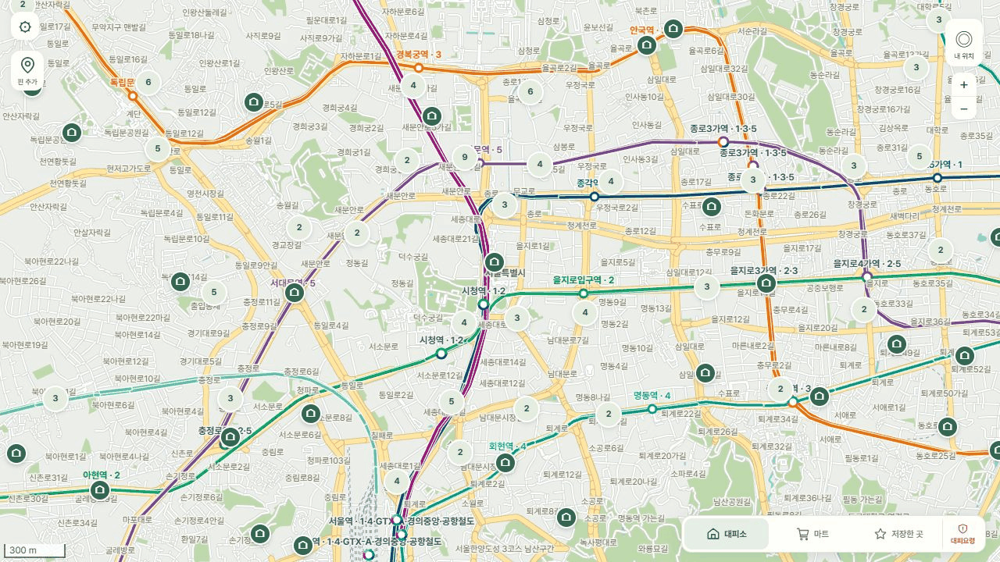
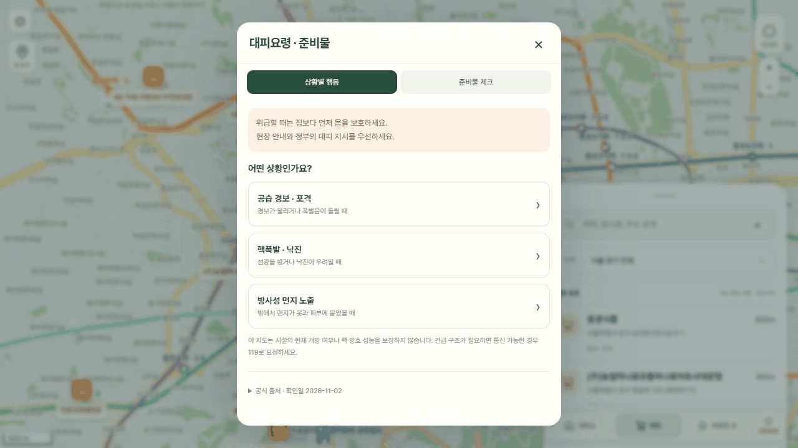
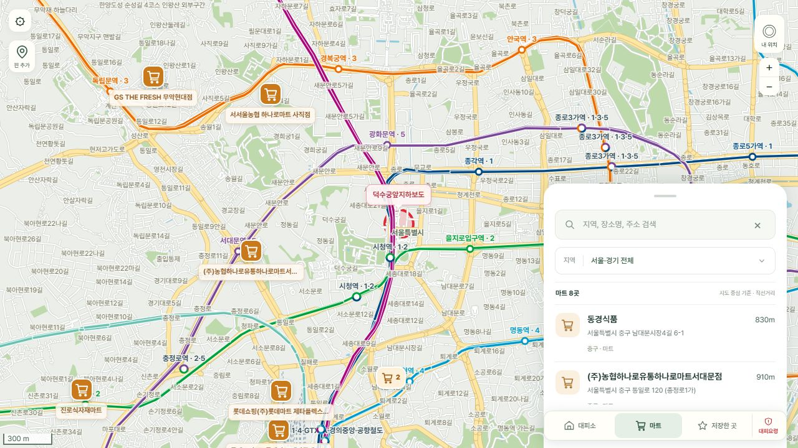
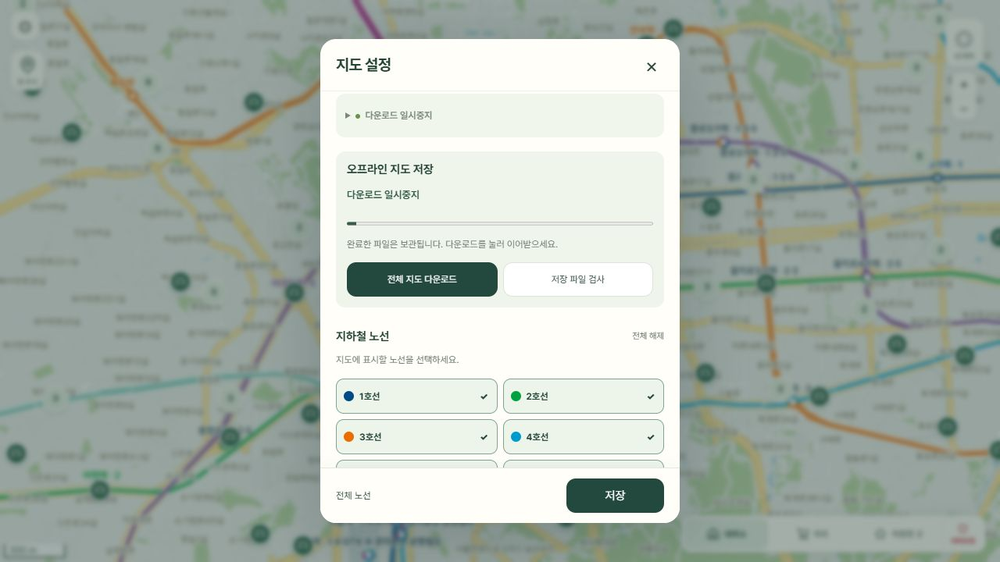

  
  <h1>오프라인 대피 지도</h1>
  
<strong>통신이 끊겨도, 저장한 지도에서 대피 장소를 찾을 수 있도록.</strong>

  
서울·경기 대피소 · 서울 마트 · 내 장소 · 대피요령

  
<a href="https://jung2un.github.io/offline-shelter-map/">iPhone용 공개 웹앱 열기</a> · <a href="#화면-미리보기">화면 미리보기</a> · <a href="DEV.md">설치·개발 안내</a>

## 어떤 앱인가요?

**지도와 장소 정보를 기기에 저장해 인터넷 없이 찾아보는 대피 지도입니다.** 원래 지도 데이터를 내장한 모바일 앱으로 구성했으며, Android 앱과 iOS 앱 소스를 제공합니다.

iOS 앱은 설치·배포에 Apple 계정과 서명·프로비저닝 관리가 필요합니다. 이 부담을 줄이기 위해 **공개 배포본은 iPhone용 오프라인 웹앱(PWA)**으로 구성했습니다. 사용자는 개발자 등록 없이 Safari에서 홈 화면에 추가해 이용할 수 있습니다. [iOS 설치 방식 자세히 보기](DEV.md#ios)

| 이용 방식 | 구성 | 제공 상태 |
| :--- | :--- | :--- |
| **iPhone용 공개 웹앱** | 홈 화면에 추가하고 전체 지도 다운로드 | [바로 열기](https://jung2un.github.io/offline-shelter-map/) · 실기기 검증 필요 |
| Android 앱 | 지도·글꼴·장소 데이터를 APK에 내장 | 소스와 APK 빌드 스크립트 제공 |
| iOS 네이티브 앱 | 같은 화면과 데이터를 WKWebView로 실행 | Xcode 프로젝트 제공 · 서명된 IPA 미제공 |

> **웹앱은 처음 한 번 인터넷 연결 상태에서 전체 지도(약 715MiB)를 저장해야 합니다.** 설정에서 ‘오프라인 준비 완료’를 확인한 뒤 사용하세요. [iPhone 사용 방법](DEV.md#iphone-오프라인-웹앱-사용배포)

## 주요 기능

| 기능 | 할 수 있는 일 |
| :--- | :--- |
| **대피소 찾기** | 서울·경기 대피소를 지역·장소명·주소로 검색하고, 선택한 위치로 지도 이동 |
| **마트 찾기** | 서울 마트를 검색하고 상세 정보·위치 확인 |
| **내 장소 저장** | 장소를 즐겨찾거나 지도에 핀을 놓고 직접 이름을 붙여 저장·수정·삭제 |
| **지도 탐색** | 남한 지도 이동·확대, 현재 화면의 장소 묶음 표시, 드래그로 목록 열기·닫기 |
| **지하철 표시** | 여러 노선을 선택해 호선별 색상으로 지도에 표시 |
| **대피요령** | 공습·포격, 핵폭발·낙진, 방사성 먼지 노출 중 상황을 골라 단계별 안내 확인 |
| **준비물 체크** | 집 비축품·대피 가방·정기 점검 항목을 체크하고 기기에 기록 저장 |
| **오프라인 저장** | 전체 지도 다운로드, 진행률 확인, 일시중지·이어받기, 저장 파일 검사 |

**데이터 범위:** 대피소 6,947개(서울·경기) · 마트 1,034개(서울) · 남한 지도 타일 7,962개. 2026-11-02 수집 자료이며 실시간 시설 개방·영업 정보는 아닙니다.

## 화면 미리보기

실행하지 않아도 실제 UI 흐름을 확인할 수 있습니다. GIF는 브라우저에서 촬영한 화면을 순서대로 묶은 슬라이드입니다.

### 장소 검색 → 상세 정보 → 지도 이동

### 상황 선택 → 단계별 대피요령 → 준비물 체크

| 마트 찾기 | 오프라인 지도 저장 |
| :---: | :---: |
|  |  |

데스크톱 브라우저에서 촬영한 화면입니다. iPhone 실기기 화면은 아닙니다. 이미지를 누르면 크게 볼 수 있습니다. [촬영 정보](docs/media/README.md)

## 어떻게 구축했나요?

**하나의 웹 화면을 앱과 PWA에서 공유**하고, 지도·장소·글꼴을 로컬에서 읽도록 구성했습니다.

| 영역 | 사용 기술 | 구현 방식 |
| :--- | :--- | :--- |
| 화면·조작 | HTML · CSS · JavaScript · Pretendard | 모바일 지도 중심 UI, 드래그 목록, 공통 모달·체크박스, 내장 글꼴 |
| 지도 | Leaflet · Canvas · OpenStreetMap · Natural Earth | 로컬 벡터 타일을 직접 렌더링하고 현재 지도 범위의 장소만 표시 |
| 장소 데이터 | 서울·경기 공공자료 · OSM · JSON | 수집·정제한 대피소와 마트 정보를 앱에 포함해 오프라인 검색 |
| 개인 기록 | localStorage | 즐겨찾기·사용자 핀·준비물 체크를 기기에 저장 |
| Android 앱 | Java · Android WebView | 웹 화면과 전체 지도 자산을 APK에 패키징 |
| iOS 앱 소스 | SwiftUI · WKWebView | 공통 웹 화면을 iOS 앱 리소스로 포함 |
| iPhone용 PWA | Web App Manifest · Service Worker · Cache Storage | 홈 화면 설치, 자산 저장, SHA-256 검사 후 완료 버전 활성화 |
| 배포 | Python · GitHub Actions · GitHub Pages | Release의 지도 데이터를 복원·검사한 뒤 HTTPS 웹앱 자동 배포 |

## 문서

| 문서 | 내용 |
| :--- | :--- |
| [DEV.md](DEV.md) | 실행·설치, APK 빌드, iOS·PWA, 지도 복원, 테스트·검증, 제한사항, GitHub 배포, 라이선스 |
| [데이터 안내](docs/DATA.md) | 데이터 출처·범위·이용조건 |

지도 © OpenStreetMap contributors · ODbL / Natural Earth.
